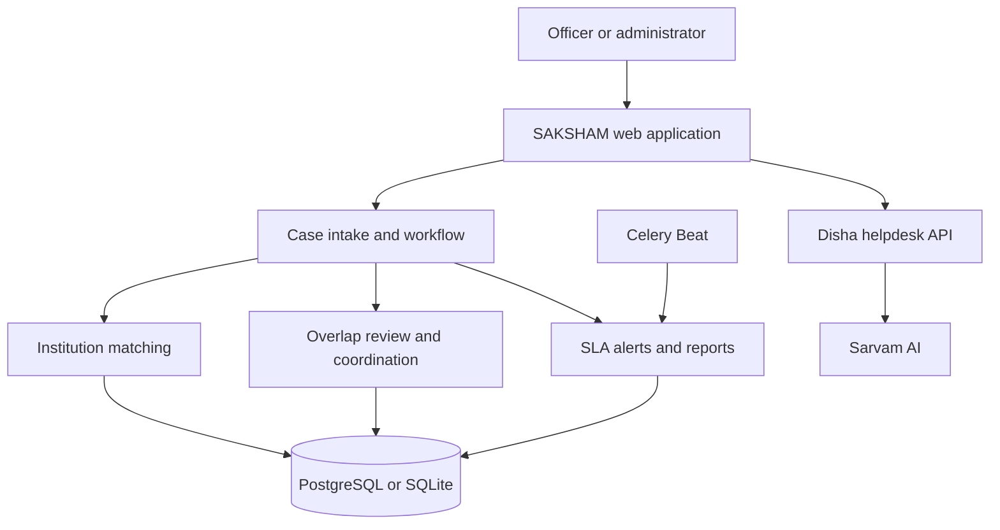

# SAKSHAM — AICTE Institution Grievance Monitor

[](https://saksham-aicte.onrender.com/)
[](https://www.djangoproject.com/)
[](https://www.python.org/)
[](https://www.docker.com/)
[](LICENSE)

[Live application](https://saksham-aicte.onrender.com/) · [Architecture](docs/ARCHITECTURE.md) · [Requirements traceability](docs/REQUIREMENTS_TRACEABILITY.md)

## Project description

SAKSHAM is a Django prototype for viewing and coordinating institution-related grievance cases across AICTE Bureaus and Cells. It brings case records into one workspace so officers can track status and deadlines, review institution matches, and identify cases that may need cross-bureau coordination.

The prototype supports CSV case imports, duplicate-safe source identifiers, canonical status mapping, institution matching, overlap review, case action history, transfer requests, SLA alerts, coordination messages, and report exports. Disha, the AI help assistant, provides general guidance on using the application; it does not read or answer questions from live case records.

The repository contains synthetic demonstration data. It does not connect to live AICTE systems or write back to source systems. Validate requirements against the official problem statement before treating the prototype as a production system.

## Dashboard preview


## Features

### Case intake and tracking

- Import cases from CSV with required-column, bureau, and status-map validation.
- Re-import a source case without creating a duplicate.
- Search and filter cases by institution, permanent ID, case ID, bureau, region, state, category, status, dates, and SLA state.
- Review case details, source fields, action history, and transfer requests.
- Download a blank CSV template or a synthetic example from the import page.

### Institution matching

- Match an institution using its AICTE Permanent ID when available.
- Suggest possible matches using normalized names and location signals.
- Review and confirm or reject uncertain matches.

### Cross-bureau coordination

- Identify open cases for the same matched institution across different Bureaus or Cells.
- Review the evidence and record a decision to confirm, relate, or reject a suggested overlap.
- Add coordination messages and receive in-app notifications.
- Request and respond to case transfers.

### SLA monitoring and reports

- View due-soon, overdue, stale, and other case alerts.
- Record workflow updates, next actions, deadlines, and remarks, subject to account permissions.
- Export the case register as CSV, Excel, or PDF.
- Review matching precision and recall against the included synthetic benchmark labels.

### Disha AI assistant

Disha is a floating help assistant available in the application. Configure a Sarvam API key to enable AI responses. The assistant offers general application guidance and does not have access to case records.

## Architecture



## Deployment

| Environment | URL | Details |
| --- | --- | --- |
| Cloud demo | [saksham-aicte.onrender.com](https://saksham-aicte.onrender.com/) | Demonstration workspace using synthetic data |
| Local development | [127.0.0.1:8000](http://127.0.0.1:8000/) | Development server |
| Admin console | [saksham-aicte.onrender.com/admin](https://saksham-aicte.onrender.com/admin/) | Django administration |

## Local setup

### Prerequisites

- Python 3.10 or later
- Git
- Optional: Docker Desktop

### Install

```bash
git clone https://github.com/chirag-433/revamp.git
cd revamp
python -m venv .venv
```

Activate the virtual environment:

```bash
source .venv/bin/activate
```

For Windows PowerShell:

```powershell
.\.venv\Scripts\Activate.ps1
```

Install dependencies:

```bash
python -m pip install --upgrade pip
pip install -r requirements.txt
```

### Configure environment

```bash
cp .env.example .env
```

Set `DJANGO_SECRET_KEY` in `.env`. To use Disha, set `SARVAM_API_KEY` as well.

### Prepare the database

```bash
python manage.py migrate
python manage.py seed_demo
python manage.py seed_match_benchmark
python manage.py createsuperuser
```

### Start the development server

```bash
python manage.py runserver 127.0.0.1:8000
```

Open [http://127.0.0.1:8000/](http://127.0.0.1:8000/) in a browser.

## Docker

Start the application services:

```bash
docker compose up --build -d
docker compose exec web python manage.py migrate
docker compose exec web python manage.py seed_demo
docker compose exec web python manage.py seed_match_benchmark
```

The application is available at [http://localhost:8000](http://localhost:8000).

## Tests and evaluation

Run the Django test suite:

```bash
python manage.py test
```

Run the matching benchmark:

```bash
python manage.py evaluate_benchmarks
```

## Project structure

```text
revamp/
├── complaints/
│   ├── management/commands/
│   ├── migrations/
│   ├── services/
│   ├── admin.py
│   ├── api.py
│   ├── models.py
│   ├── tests.py
│   └── views.py
├── config/
├── docs/
├── static/
├── templates/
├── Dockerfile
├── docker-compose.yml
├── manage.py
└── requirements.txt
```

## Demonstration scope

- Records and case narratives in the repository are synthetic.
- Overlap detection creates coordination suggestions; it does not merge source cases.
- Case history and coordination decisions are recorded for review.
- Production integrations, source-system write-back, and real complainant data are outside the prototype scope.

## License

This project is licensed under the MIT License. See [LICENSE](LICENSE).

Developed as a Smart India Hackathon prototype for AICTE institution grievance coordination.
