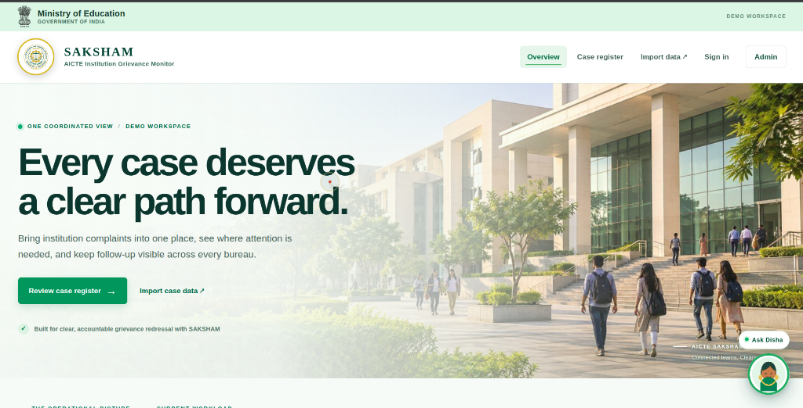
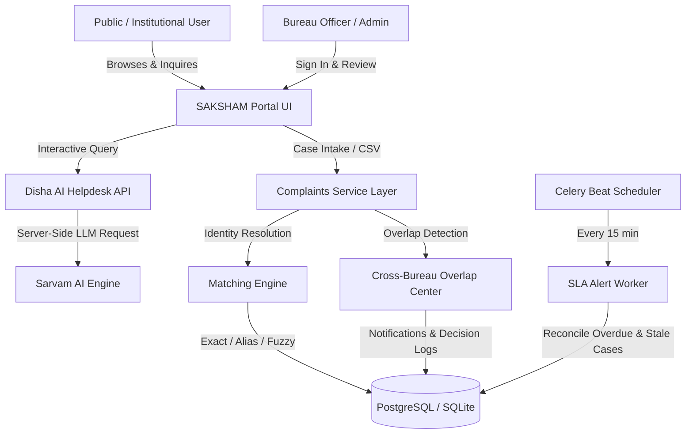

# SAKSHAM · AICTE Institution Grievance Monitor

<div align="center">


**A Unified National Grievance Monitoring, Identity Resolution & Cross-Bureau Overlap Coordination Platform**

[](https://saksham-aicte.onrender.com/)
[](https://www.djangoproject.com/)
[](https://www.python.org/)
[](https://www.docker.com/)
[](LICENSE)

[🌐 Access Live Application](https://saksham-aicte.onrender.com/) · [📖 Architecture Docs](docs/ARCHITECTURE.md) · [📊 Requirements Traceability](docs/REQUIREMENTS_TRACEABILITY.md)

</div>

---

## 📌 Overview

**SAKSHAM** is an institutional casework and grievance coordination platform developed for the **All India Council for Technical Education (AICTE)**, Ministry of Education, Government of India.

AICTE handles grievance intake and compliance casework across distinct functional Bureaus and Cells:
- **Approval Bureau (AB)**: Extension of Approval (EoA), land/infrastructure compliance, intake sanctions.
- **Policy & Academic Planning Bureau**: Curriculum norms, faculty regulations, academic grievances.
- **Public Grievance Redressal Cell (PGRC)**: Student, parent, and faculty complaints.
- **Regional Offices / Regional Bureaus (RB)**: Inspection follow-ups, state-level verification, operational enforcement.

Previously, grievances against the same institution could be lodged simultaneously across multiple channels without cross-Bureau visibility, leading to duplicated effort, inconsistent status determinations, and missed SLA deadlines.

**SAKSHAM** solves this by establishing **one coordinated operational picture**:
1. **Deterministic & Fuzzy Identity Resolution**: Resolves arbitrary input names to official AICTE Permanent IDs (PID).
2. **Cross-Bureau Overlap Detection**: Uncovers parallel and overlapping complaints filed across different bureaus.
3. **Audited Officer Decisions**: Facilitates human-in-the-loop review, coordinated transfers, and shared case notes.
4. **SLA Monitoring & Escalation Scoring**: Automated real-time alerts for stale, overdue, and urgent cases.
5. **Disha AI Assistant**: Conversational assistant powered by Sarvam AI for immediate grievance triage and guidelines lookup.

---

## 🖥️ Platform Preview



*SAKSHAM overview dashboard featuring real-time workload counts, active SLA risks, priority distribution, and recent intake records.*

---

## 🚀 Key Features

### 1. 🏛️ National Case Register & Intake
- Centralized register of all complaints and compliance filings across all AICTE Bureaus.
- Repeat-safe CSV intake with automatic validation, canonical status mapping, and duplicate handling.
- Multi-filter search by Bureau, resolution state, institution, and priority ranking.

### 2. 🔍 3-Tier Institution Matching
- **Tier 1 (Exact PID)**: Instant, deterministic linkage when a valid AICTE Permanent ID is present.
- **Tier 2 (Canonical Alias)**: Matches normalized institution names against pre-indexed institutional aliases.
- **Tier 3 (Fuzzy Matcher)**: Levenshtein distance and token-ratio matching for misspelled or colloquially named colleges.
- **Officer Match Queue**: Borderline suggestions (70%–89% confidence) route to an officer review screen for one-click confirmation.

### 3. ⚡ Cross-Bureau Overlap Center
- Flags overlapping complaints concerning the same institution across multiple bureaus (e.g. concurrent faculty salary complaints in PGRC and fraud allegations in Approval Bureau).
- Audited coordination threads and in-app notifications between Bureau officers.
- Transfer workflow allowing cases to be reassigned between Bureaus with complete provenance history.

### 4. ⏱️ Automated SLA Alerts & Priority Scoring
- Real-time priority calculation engine factoring in escalation status, overdue days, unresolved identity, and inactivity.
- Automated Celery Beat task (`refresh_sla_alerts`) running every 15 minutes.
- Comprehensive multi-format reporting: Instant export to **PDF**, **Excel**, and **CSV**.

### 5. 🤖 Disha AI Assistant (Sarvam AI)
- Built-in intelligent assistant floating across all platform views.
- Answers procedural queries regarding AICTE approval norms, grievance categories, submission formats, and tracking.
- Server-side API proxy ensures credentials and keys remain secure.

---

## 🏗️ System Architecture



---

## 🌐 Live Deployment

| Environment | URL | Details |
| :--- | :--- | :--- |
| **Production / Cloud Demo** | [https://saksham-aicte.onrender.com/](https://saksham-aicte.onrender.com/) | Live cloud workspace on Render with synthetic demonstration data |
| **Local Development** | `http://127.0.0.1:8000/` | Standard local execution |
| **Admin Console** | [https://saksham-aicte.onrender.com/admin/](https://saksham-aicte.onrender.com/admin/) | Django administration with SAKSHAM emerald theme |

---

## 🛠️ Local Development Setup

### Prerequisites
- **Python 3.10+** (Python 3.12 recommended)
- **Git**
- Optional: **Docker & Docker Desktop** (for containerized setup)

### 1. Clone the Repository
```bash
git clone https://github.com/chirag-433/revamp.git
cd revamp
```

### 2. Configure Virtual Environment & Dependencies
```bash
# Create and activate virtual environment
python3 -m venv .venv
source .venv/bin/activate       # On Linux/macOS
# .\.venv\Scripts\Activate.ps1  # On Windows PowerShell

# Install dependencies
pip install --upgrade pip
pip install -r requirements.txt
```

### 3. Environment Configuration
```bash
cp .env.example .env
```
*Edit `.env` to configure your `DJANGO_SECRET_KEY` and optional `SARVAM_API_KEY` for the Disha AI assistant.*

### 4. Database Setup & Demo Seed
```bash
# Run database migrations
python manage.py migrate

# Populate synthetic demonstration dataset (Institutions, Bureaus, Overlaps, Cases)
python manage.py seed_demo
python manage.py seed_match_benchmark

# Create an administrator account
python manage.py createsuperuser
```

### 5. Launch the Development Server
```bash
python manage.py runserver 127.0.0.1:8000
```
Visit **[http://127.0.0.1:8000/](http://127.0.0.1:8000/)** in your browser.

---

## 🐳 Docker Deployment

To launch the full production-ready stack (Web App + PostgreSQL + Redis + Celery Worker + Celery Beat):

```bash
# Start all containers in the background
docker compose up --build -d

# Execute migrations and seed demo data inside the container
docker compose exec web python manage.py migrate
docker compose exec web python manage.py seed_demo
docker compose exec web python manage.py seed_match_benchmark
```
The application will be accessible at `http://localhost:8000`.

---

## 🧪 Testing & Evaluation

SAKSHAM includes a comprehensive test suite covering intake validation, fuzzy matching thresholds, cross-bureau overlap detection, role authorization, and report generation:

```bash
# Run all automated tests
python manage.py test

# Run matching evaluation benchmarks
python manage.py evaluate_benchmarks
```

---

## 📂 Project Directory Structure

```text
revamp/
├── complaints/               # Core application
│   ├── models.py            # Case, Institution, Bureau, CaseLink, Coordination models
│   ├── views.py             # Dashboard, Register, Overlap Center, Auth, and Reports views
│   ├── services/            # Matching engine, overlap detector, SLA alerts, reports
│   └── tests.py             # 43 automated unit and integration tests
├── config/                  # Django project configuration (settings, urls, wsgi, celery)
├── docs/                    # Architectural specs, traceability matrix, and runbooks
│   └── assets/              # Diagram assets and dashboard preview screenshots
├── static/                  # Static assets
│   └── complaints/          # CSS design tokens, AICTE logo emblem, JavaScript utilities
├── templates/               # Responsive HTML5 templates
│   ├── admin/               # Custom branded Django admin login and console
│   ├── complaints/          # Dashboard, Register, Overlap Center, Reports
│   └── registration/        # Officer Sign In and Register cards
├── Dockerfile               # Production container definition
├── docker-compose.yml       # Multi-service stack (Django + Postgres + Redis + Celery)
└── requirements.txt         # Project dependencies
```

---

## 🛡️ Scope & Demonstration Guardrails

- **Synthetic Data**: All institution records, complainant references, and grievance narratives in this repository are synthetic demonstration data created for prototyping.
- **Coordination, Not Automatic Merge**: SAKSHAM flags cross-Bureau overlaps as coordination opportunities; legal decisions remain in the hands of authorized AICTE officers.
- **Preserved Provenance**: Case history, status modifications, and officer coordination messages are stored in append-only timestamped audit logs.

---

## 📄 License

This project is licensed under the MIT License — see the [LICENSE](LICENSE) file for details.
Developed as part of the Smart India Hackathon (SIH) prototype initiative for AICTE Institution Complaint Redressal.
