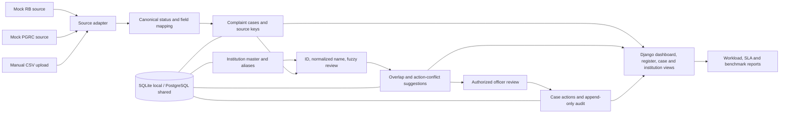

# Prototype architecture

The current application is a single Django service with server-rendered pages and a relational database. It supports SQLite for local demonstration and PostgreSQL through `DATABASE_URL`. The source adapters do not call or modify live AICTE systems.

## Source adapter contract

Each adapter should return canonical dictionaries containing `source_system`, `source_case_id`, `bureau_code`, `raw_institution_name`, `source_status`, and optional case fields. The importer uses `(source_system, source_case_id)` as the idempotency key. Unknown bureau codes and unmapped statuses are returned as row-level errors. Human-entered case actions remain separate from source refreshes.

## Production path, pending approval

After source owners approve access, a scheduled adapter could read a REST endpoint, a database view, or a scheduled file drop. A queue and worker can be introduced if source volume or response-time measurements require them. The production diagram should add managed PostgreSQL, a job queue, monitoring, backups, identity federation, and approved network controls only after those choices are confirmed.
